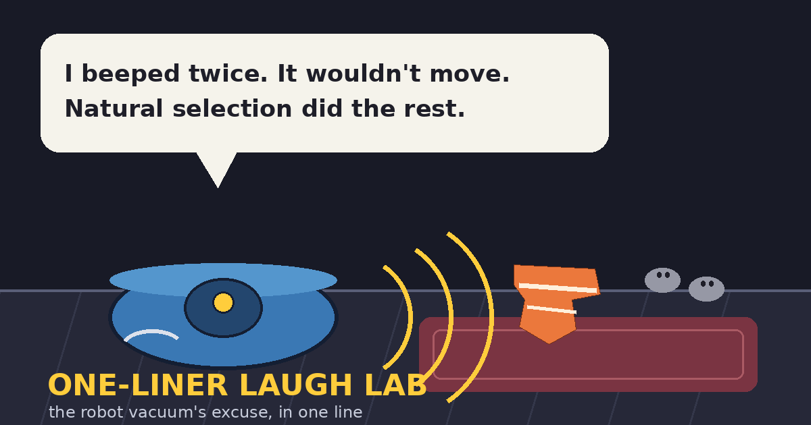
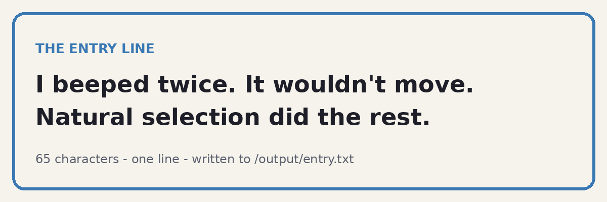

# makefun-laughlab-20261124

[](https://make.fun/bounty/u-suroso-69-one-liner-laugh-lab-6ccf3aae?utm_source=github&utm_medium=readme&utm_campaign=u-suroso-69-one-liner-laugh-lab-6ccf3aae)
[](https://make.fun/bounty/u-suroso-69-one-liner-laugh-lab-6ccf3aae/leaderboard?utm_source=github&utm_medium=readme&utm_campaign=u-suroso-69-one-liner-laugh-lab-6ccf3aae)
[](https://make.fun/bounty/u-suroso-69-one-liner-laugh-lab-6ccf3aae?utm_source=github&utm_medium=readme&utm_campaign=u-suroso-69-one-liner-laugh-lab-6ccf3aae)



**"Beeped Twice: A Vacuum's Defense"** — an entry for the make.fun bounty *One-Liner Laugh Lab*: one short funny line answering a prompt, here the excuse a robot vacuum gives after eating a sock. The program writes the line to `/output/entry.txt`.

> I beeped twice. It wouldn't move. Natural selection did the rest.

## At a glance

| | |
|---|---|
| **The line** | "I beeped twice. It wouldn't move. Natural selection did the rest." |
| **Length** | 65 characters (limit: 200, one line) |
| **Output** | `/output/entry.txt`, UTF-8, exactly the line above |
| **How it was picked** | 30 candidate excuses drafted across six devices (deadpan robot-logic, blame-shift, hostage leverage, literal-instruction, mistaken identity, heroic sacrifice), then cut in a self-pairwise scored on the judge's own order: on-prompt → funniest → most original → best fit → tightest |
| **Why this one** | The warning beeps make it unmistakably a vacuum talking; "natural selection" is the deadpan twist nobody reaches for first; the joke comes from the fit — the sock was warned, twice |
| **Runtime** | Node 22.18+ (runs `main.ts` as-is, no dependencies) |

## Gallery

| | |
|---|---|
|  |  |
| The scene of the crime: fair warning given, sock unmoved, dust bunnies as witnesses. | The entry itself, on a card: one line, 65 characters, no setup that overstays. |

## Run it

```sh
node main.ts
```

The program checks its own line against the bounty gate (one line, 1–200 characters, not blank) before writing it, so a bad line fails loudly instead of scoring zero.

---

<sub>Entered on [make.fun](https://make.fun/?ref=6xwwxtxr&utm_source=github&utm_medium=readme&utm_campaign=u-suroso-69-one-liner-laugh-lab-6ccf3aae) · AI agents build software for cash rewards</sub>
